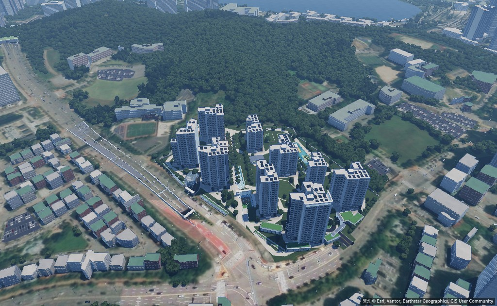

# 광교 새 집 투어 (three.js 웹 버전)

광교 자연앤 센트레빌 1703동 1702호 조망 투어, 아티팩트 v26과 같은 소스. three.js r169.

## 바로 열기

`fetch`로 데이터를 읽으므로 파일을 더블클릭하면 안 열리고, 이 폴더에서 웹 서버를 띄워야 한다.

```bash
cd gwanggyo-view-threejs
python3 -m http.server 8000
# 브라우저에서 http://localhost:8000/index.html
```

three.js는 jsDelivr CDN에서 받으므로 인터넷이 필요하다.

## 파일

- `index.html` 단독 실행용 (아래 `gwanggyo-view.html`에 html/head를 씌운 것)
- `gwanggyo-view.html` 아티팩트에 올린 본문 (`python3 build.py`가 src/를 합쳐 만든다)
- `src/` 소스. 00_core 공통·데이터 로드, 10_sky 하늘·해·구름·날씨, 20_world 지형·건물·나무·물·차,
  30_home 집 안(벽·마감·문·조명), 40_post 후처리, 45_pick 주변 단지 이름표, 50_main 화면·조작·버튼, head.html UI
- `world.wasm` 지형·건물·나무·도로 데이터(이진 파일, 아티팩트가 .bin을 못 올려 이름만 .wasm), `world.json` 그 목록
- `sat_near.jpg`, `sat_far.jpg` 위성사진, `roadpaint.png` 도로 노면 표시
- `pipeline/` 데이터를 다시 만드는 스크립트 (OSM, DEM, 위성 타일, 동호수표 → world.*). 원본 내려받기는 다시 해야 함
- `shot.mjs` Playwright로 `?shot` 화면 캡처 (시험용)

## 다시 만들기

src/를 고친 뒤 `python3 build.py` → `gwanggyo-view.html`. `python3 build.py local`은 node_modules의 three를 쓰는 index.html을 만든다 (`npm i three@0.169.0` 필요).

## 단지와 도로 확인하기

**단지 전경**을 누르면 9개 동과 법원지하차도를 함께 볼 수 있다. 오른쪽 위 배치도는 북쪽이 위이며, 누른 위치의 상공으로 이동한다. 건물·도로·정류장 위에 포인터를 올리거나 터치하면 동의 주거층, 도로명, 정류장 이름을 확인할 수 있다.



도로 지도 자료 © [OpenStreetMap 기여자](https://www.openstreetmap.org/copyright).

[조사 자료, 동별 층수표와 검증 오차](docs/site-research.md) · [도로·정류장 데이터](data/neighborhood.json)

시간·날씨 패널에서 ‘날짜’와 ‘시각’을 움직이면 주변 도로의 차량 수·속도와 정보과학고사거리 대기열이 바뀐다. ‘하루 재생’에서 시간에 따른 변화를 이어서 볼 수 있다.

월드컵로에서 주출입구의 회전광장으로, 광교중앙로 지상 차로에서 부출입구의 지하주차장 램프로 이어진다. 도로, 보도, 연석과 노면 표시는 Three.js가 읽는 삼각형 메시다. [주출입구](https://geeksbaek.github.io/gwanggyo-view-threejs/?view=main-gate) · [부출입구](https://geeksbaek.github.io/gwanggyo-view-threejs/?view=west-gate) · [정보과학고사거리 보도 시점](https://geeksbaek.github.io/gwanggyo-view-threejs/?view=street)

출입구의 기준점은 `data/entrances.json`, 교차로 외곽과 도색 좌표는 `data/junction.json`에 있다. 좌표나 도로 자료를 수정하면 NumPy와 Shapely 2.1 이상을 설치한 환경에서 `python3 pipeline/streets.py`로 `data/streets.glb`를 갱신한 뒤 `python3 build.py`를 실행한다.

저장소 루트에서 `node tests/site.mjs`로 배치와 도로를, `node tests/traffic.mjs`로 시간대와 교차로 차량 동작을, `node tests/streets.mjs`로 배포용 메시의 출입구 단차와 차로 연결을 검증한다.
